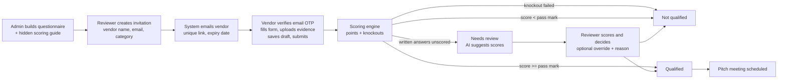

# HexaQualify — Build Specification

*Pre-pitch vendor screening for Hexamatics Group*

**Owner:** Praphulla (Asim) Subedi, Hexamatics Group · **Version:** 1.1 · **Date:** 31 Oct 2026
**Audience:** Claude Code (implementation) and the HEX engineering team

---

## 1. Purpose

Every vendor that wants to pitch to Hexamatics must first complete a **pre-pitch screening questionnaire**. Different vendors provide different services, so each **service category** has its own questionnaire and its own **hidden scoring guide**. The system:

1. sends the right questionnaire to the vendor through a secure link,
2. collects the vendor's answers,
3. scores them automatically against the scoring guide,
4. applies **knockout (must-pass) criteria**, and
5. returns **Qualified / Not qualified / Needs review**, with a reviewer able to confirm or override.

A vendor only gets a pitch meeting if the result is **Qualified** (or a reviewer overrides to Qualified with a recorded reason).

### Out of scope (v1)
- Full vendor onboarding or master data, contracts, purchase orders.
- Payments or invoicing.
- Public self-registration by vendors without an invitation. Vendors can only respond through an invitation link.

---

## 2. Roles

| Role | Who | Can do |
|---|---|---|
| **Admin** | Finance / procurement lead | Everything: manage questionnaires and scoring guides, settings, users; see all responses; override decisions; delete. |
| **Reviewer** | Procurement, finance, IT, legal staff | Create invitations, view responses and scores (including the guide), score written answers, record decisions. Cannot edit questionnaires or guides. |
| **Viewer** | Management | Read-only access to the dashboard and decisions. |
| **Vendor** | External company | Opens their own invitation link, fills in and submits **their** questionnaire, uploads evidence. Never sees points, pass marks, knockout rules, other vendors or results (unless Hexa chooses to notify them). |

All staff sign in with Google Workspace SSO (`@hexamatics.com`, plus other group domains configurable). MFA is enforced through the IdP. Vendors do not create accounts; they authenticate with the invitation token plus an email one-time code (see §7).

---

## 3. End-to-end flow



### Invitation states
`draft → sent → opened → in_progress → submitted → scored → decided` plus `expired` and `revoked`.

### Result values
`Pass` (Qualified), `Fail` (Not qualified), `Review` (written answers still unscored), `Unscored` (no guide found). The **final result** is the reviewer override if present, otherwise the calculated result.

---

## 4. Functional requirements

### 4.1 Questionnaire builder (Admin)
- Create, edit, duplicate, archive questionnaires. Each one has: name, service category, description shown to vendors, pass mark (0–100% of max points), active flag.
- A questionnaire contains **sections**, and each section contains ordered **questions**.
- Question types:

| Type | Vendor input | Scoring |
|---|---|---|
| `yesno` | Yes / No radio | Full points if answer equals the expected answer, else 0. Optional knockout if the answer is not the expected one. |
| `choice` | Single choice | Points per option. Max points = highest option value. Optional knockout options. |
| `number` | Number with unit | Full points if the threshold is met (`>=` or `<=` a value), else 0. Optional knockout if not met. |
| `text` | Free text (max 3,000 chars) | Reviewer scores 0..max (half points allowed). AI can suggest a score. Max 0 = information only. |
| `file` *(phase 2)* | Upload (PDF/JPG/PNG, max 10 MB) | Reviewer marks the evidence valid or invalid. Can be a knockout (e.g. tax clearance certificate). |

- Each question has: text, optional help text (shown to vendors), required flag, and an optional `evidence_required` flag (phase 2).
- Each question's **scoring guide** has: weight (points), rule fields per type, knockout flag or options, and a "what good looks like" note. **The guide is stored separately and never sent to vendor-facing endpoints.**
- **Versioning:** every save creates a new immutable version. Invitations and responses are pinned to the version they were sent with, so later edits never rescore past responses unless an Admin explicitly clicks "Rescore with latest guide" (logged).
- **Common baseline section:** a reusable "Company and integrity" section applies to all categories. Store it as a reusable section block that questionnaires include by reference.

### 4.2 Invitations (Reviewer)
- Create an invitation with: vendor company name, contact name, contact email, questionnaire (category), expiry (default 14 days), optional internal note.
- The system emails the vendor a branded invitation with a unique link: `https://<host>/v/<token>`. The token is 32+ bytes from a CSPRNG and is stored hashed (SHA-256).
- Actions: resend, extend expiry, revoke, copy link.
- Bulk invite from CSV (phase 2).
- Duplicate guard: warn if the same vendor email already has an open invitation for the same questionnaire.

### 4.3 Vendor portal
- Opening the link asks for a 6-digit OTP sent to the invited email (10-minute validity, 5 attempts, then lock for 15 minutes).
- Hexa-branded glass letterhead (see §10). Shows questionnaire name, description, deadline, and instructions.
- Vendor details captured: company name, PAN/VAT number, contact person, designation, email, phone.
- Autosave the draft every 10 seconds and on blur. "Save and continue later" works from the same link until expiry.
- Validation: all required questions answered; numbers numeric; text length limits. Missing items are highlighted and the page scrolls to the first one.
- Declaration checkbox before submit: *"I confirm the answers are accurate and may be verified by Hexamatics."*
- After submission the form is read-only, with a confirmation page and a confirmation email. No score or result is shown to the vendor.
- Mobile-friendly; works at 375 px width.

### 4.4 Scoring engine
Specified in §6. Runs on the server on submit, on reviewer save, and on an explicit rescore. Results are stored as a snapshot with the guide version used.

### 4.5 Review and decision (Reviewer)
- The response detail page shows: vendor details, result badge, score % against the pass mark (bar with a marker), points (x of y), a list of failed knockouts, and pending written answers.
- Per question it shows: the answer, the guide rule plus note, points awarded, and a knockout flag.
- For `text` questions: a points input (0..max, step 0.5). The **"Suggest scores with AI"** button calls the LLM (§6.4), fills the inputs and shows a one-sentence reason each. Nothing is saved until the reviewer clicks Save.
- Decision panel: use the calculated result, or override to Pass or Fail. **A reason is mandatory for any override.** Reviewer notes are kept.
- "Request clarification" (phase 2) reopens specific questions to the vendor with a message, and the invitation returns to `in_progress`.
- Every decision is written to the audit log.

### 4.6 Dashboard
- KPI tiles: total responses, Qualified, Not qualified, Needs review, invitations pending.
- Table: vendor, questionnaire, received date, score % with pass-mark marker, number of knockouts failed, final result, decided by.
- Filters: questionnaire or category, result, date range, search by vendor.
- Export to XLSX/CSV (respecting role permissions).

### 4.7 Notifications (email)
| Trigger | To |
|---|---|
| Invitation created or resent | Vendor |
| OTP | Vendor |
| Reminder 3 days before expiry if not submitted | Vendor |
| Vendor submitted | Inviting reviewer (+ optional distribution list) |
| Result decided (optional, toggle per invitation) | Vendor: "qualified, we will contact you" or a polite decline. Never disclose scores. |

### 4.8 Settings (Admin)
- Allowed staff domains, default expiry, sender name and reply-to address, notification distribution list, data retention period, AI scoring on/off.

---

## 5. Data model

PostgreSQL. Use UUID primary keys and `timestamptz` throughout. Soft-delete with `deleted_at` where noted.

```text
users                 id, email, name, role[admin|reviewer|viewer], active, last_login_at
questionnaires        id, slug, name, category, description, active, created_by, deleted_at
questionnaire_versions id, questionnaire_id, version, pass_mark, structure_json, created_by, created_at
                      -- structure_json = sections[] → questions[] (vendor-safe: no scoring fields)
scoring_guides        id, questionnaire_version_id, guide_json, created_at
                      -- guide_json = { passMark, q: { <question_id>: {weight, expected?, points?, koOptions?, op?, value?, ko?, note} } }
invitations           id, questionnaire_version_id, vendor_company, contact_name, contact_email,
                      token_hash, status, expires_at, sent_at, opened_at, created_by, note, notify_result bool
otp_challenges        id, invitation_id, code_hash, expires_at, attempts, locked_until
responses             id, invitation_id (unique), vendor_json, answers_json, declaration_at,
                      submitted_at, submitted_ip, user_agent
response_files        id, response_id, question_id, storage_key, filename, mime, size, sha256, av_status
scores                id, response_id, guide_id, score, max, pct, knockouts_json, pending_json,
                      manual_json, result, ai_suggestions_json, computed_at, computed_by
decisions             id, response_id, final_result, override bool, reason, decided_by, decided_at
audit_log             id, actor_type[user|vendor|system], actor_id, action, entity, entity_id,
                      before_json, after_json, ip, created_at   -- append-only
```

Rules:
- `scoring_guides` is readable only by Admin and Reviewer roles. Vendor endpoints must never join to it.
- `responses.answers_json` is keyed by question id: `{ "c1": "yes", "c3": 5, "c9": "text…" }`.
- Each new score row supersedes the previous one; keep history.

---

## 6. Scoring engine

### 6.1 Algorithm

```text
function score(version, guide, answers, manual):
  score = 0; max = 0; knockouts = []; pending = []
  for q in version.questions:
    g = guide.q[q.id]; w = g.weight; a = answers[q.id]; pts = 0
    switch q.type:
      yesno:  pts = (a == g.expected) ? w : 0
              if g.ko and a != g.expected: knockouts.add(q.id)
      choice: pts = g.points[a] ?? 0                    # w = max(g.points)
              if a in g.koOptions or (a missing and g.koOptions not empty): knockouts.add(q.id)
      number: met = a is numeric and (g.op == ">=" ? a >= g.value : a <= g.value)
              pts = met ? w : 0
              if g.ko and not met: knockouts.add(q.id)
      text:   if w == 0: info only
              elif manual[q.id] is null: pending.add(q.id)
              else pts = clamp(manual[q.id], 0, w)
      file:   (phase 2) like yesno, with "valid" as the expected value set by the reviewer
    score += pts; max += w
  pct = round(score / max * 100, 1)
  result = knockouts ? "Fail"
         : pending   ? "Review"
         : pct >= guide.passMark ? "Pass" : "Fail"
  return {score, max, pct, knockouts, pending, result}
```

Final result = `decision.final_result` if a decision exists, else `score.result`.

### 6.2 Worked example (HR & payroll software, pass mark 75%)
- Max points 129. The vendor scores 104 on closed questions and has two text answers pending → **Review**.
- The reviewer scores c9 = 4/5. → 108/129 = 83.7%. No knockouts → **Pass**.
- If the vendor had answered **"Not specified"** for hosting location (h7), that is a knockout → **Fail** regardless of score.

### 6.3 Unit tests (must pass)
1. Every knockout question answered wrongly → `Fail`, even at 99%.
2. All correct but a text answer unscored → `Review`.
3. Exactly at the pass mark → `Pass` (inclusive).
4. Missing optional choice answer with no KO options → 0 points, no knockout.
5. Number threshold with `<=` (e.g. breach notification 72 h): 72 → met, 73 → not met.
6. Changing the guide after submission does **not** change a stored score until an explicit rescore.
7. Manual points above max are clamped.
8. Override without a reason is rejected (HTTP 422).

### 6.4 AI-assisted scoring of written answers
- Server-side call to the Claude API (`claude-sonnet-5-5` or the configured model). The API key is held server-side only.
- Send per question: question text, max points, the "what good looks like" note, the vendor's answer, and the category. **Do not send** vendor contact details or PAN.
- Prompt rules: score strictly against the guide; 0 for empty, generic or evasive answers; full marks only for specific answers that clearly meet the guide; half points allowed. Return JSON `{"scores":[{"id","points","reason"}]}` with each reason at most 25 words.
- Validate the JSON and clamp points. Store the suggestions in `scores.ai_suggestions_json`. **The AI never decides alone**: suggestions pre-fill the inputs, and a human saves them.
- If the call fails, show a toast and let the reviewer score manually.

---

## 7. Security, privacy and compliance requirements

These are mandatory. The tool holds vendor company data and staff identities, and it is a control over who gets to pitch.

**Access control**
- Staff: SSO (Google Workspace, OIDC) restricted to allowed domains; MFA enforced through the IdP; role-based authorisation checked server-side on every endpoint.
- Vendors: hashed single-invitation token plus email OTP. The token scope is limited to that invitation's form, draft and submit endpoints. Rate-limit OTP and token endpoints (e.g. 10 requests per minute per IP and per token).
- Vendor API responses contain the vendor-safe `structure_json` only. Add an automated test asserting that no vendor endpoint payload contains `weight`, `expected`, `points`, `koOptions`, `passMark` or `note`.

**Data protection**
- TLS 1.2+ everywhere, with HSTS. Encryption at rest for the database and object storage.
- Individual Privacy Act 2075 (Nepal): collect only what is needed, show a privacy notice on the vendor portal, and give a defined retention period (default 3 years after decision, configurable). Run a purge job.
- Hosting region documented. If hosted in Nepal, use a provider listed under the Data Center and Cloud Service Directives 2081.
- Uploaded files: type and size validation, antivirus scan (ClamAV) before reviewer access, private bucket, short-lived signed URLs.

**Application security**
- Follow the OWASP ASVS L2 baseline: CSRF protection, output encoding (no raw HTML from vendor input), parameterised queries, secure cookies (`HttpOnly`, `Secure`, `SameSite=Lax`), strict CSP, and no secrets in the client.
- Append-only audit log of logins, invitation actions, submissions, score changes, overrides, exports, guide edits and deletions.
- Dependency scanning in CI (e.g. `composer audit` / `npm audit`), plus a pen test before go-live.
- Daily encrypted backups, 30-day retention, with a quarterly restore test.

**Integrity**
- Submissions are immutable. Corrections go through "request clarification", which creates a new revision while keeping the original.
- Store the IP, user agent and timestamp of the declaration.
- A conflict-of-interest field on decisions (reviewer confirms no relationship with the vendor).

---

## 8. Suggested technology

Match the HEX team's existing Laravel skills (as used for HooRA):

- **Backend:** Laravel 11, PHP 8.3, PostgreSQL 16, Redis queues, Laravel Socialite (Google), Sanctum for vendor token sessions, Laravel Mail with SES/SMTP, S3-compatible storage.
- **Frontend:** Inertia + Vue 3 (or Livewire 3), Tailwind CSS with the §10 glassmorphism tokens.
- **AI:** Anthropic PHP SDK or a direct HTTPS call, executed in a queued job.
- **Testing:** Pest. Scoring engine as a pure PHP service class with 100% unit-test coverage.
- **Deploy:** Docker; one app container, one worker, Postgres, Redis. GitHub Actions CI.

*Alternative if preferred:* Next.js 15 + Postgres (Prisma) + Auth.js. The spec is stack-neutral apart from this section.

---

## 9. API outline

Staff (session auth, role-checked):
```text
GET    /api/questionnaires                    list (with active version)
POST   /api/questionnaires                    create            [admin]
PUT    /api/questionnaires/{id}               new version       [admin]
POST   /api/questionnaires/{id}/duplicate                       [admin]
GET    /api/questionnaires/{id}/guide         scoring guide     [admin, reviewer]
POST   /api/invitations                       create + send     [admin, reviewer]
POST   /api/invitations/{id}/resend|revoke|extend
GET    /api/responses?filters                 dashboard list
GET    /api/responses/{id}                    detail with score breakdown
POST   /api/responses/{id}/manual-scores      save text scores
POST   /api/responses/{id}/ai-suggest         queue AI suggestion
POST   /api/responses/{id}/decision           {final_result, override, reason}
POST   /api/responses/{id}/rescore            [admin]
GET    /api/export/responses.xlsx
```
Vendor (invitation token + OTP session):
```text
GET    /v/{token}                             landing → OTP request
POST   /v/{token}/otp  /v/{token}/otp/verify
GET    /v/{token}/form                        vendor-safe structure + saved draft
PUT    /v/{token}/draft                       autosave
POST   /v/{token}/files                       upload evidence (phase 2)
POST   /v/{token}/submit                      validate + lock + score (async)
```

---

## 10. Branding and UI design system — Hexa brand, modern glassmorphism

**Product name:** **HexaQualify**. Tagline: *Pre-pitch vendor screening.*
Results wording: **Qualified** (eligible to pitch) · **Not qualified** · **Needs review**. Never show scores to vendors.

### 10.1 Hexa logo and brand assets

Download these official assets into `resources/brand/` (or `public/brand/`) and commit them. Do not redraw or recolour the logo.

| Asset | Source | Use |
|---|---|---|
| Logo (dark ink, for light backgrounds) | `https://www.hexabusiness.com/wp-content/uploads/logo-black.svg` | Header and letterhead in light theme, PDF exports |
| Logo (alternate/footer version) | `https://www.hexabusiness.com/wp-content/uploads/logo2.svg` | Dark theme header, footer; confirm it reads on dark glass, else use a white single-colour version supplied by marketing |
| Icon | `https://www.hexabusiness.com/wp-content/uploads/Hexa-Icon.png` | Favicon (32/180/512 px), PWA icon, email header on small screens |

Rules:
- Clear space around the logo equals at least the height of the hexagon mark. Minimum width 96 px on the web.
- Header lockup: `[Hexa logo] | HexaQualify`. Use a 1 px divider with the product name in the display font at 60% of the logo height.
- Place the logo on a glass surface with ≥ 4.5:1 contrast behind it. Never place it directly over the busiest part of the background gradient.
- If marketing provides an official brand guideline, its colours, fonts and logo rules **override** §10.2–10.3.

**Brand colours:** extract the primary hex values from `logo-black.svg` / `logo2.svg` (their `fill` attributes) and set them as `--hexa-primary` and `--hexa-secondary` below. Until confirmed, use the placeholder palette in §10.2.

### 10.2 Design tokens

Implement these as CSS variables and expose them through the Tailwind config. All component colours must come from tokens. Support light and dark themes, follow `prefers-color-scheme`, and add a manual toggle.

```css
:root {
  /* Brand — replace with values from the Hexa logo SVG */
  --hexa-primary: #0D2C4B;      /* deep navy (placeholder) */
  --hexa-secondary: #0B8F8C;    /* teal (placeholder) */
  --hexa-accent: #3CC4BF;       /* light teal for highlights */

  /* Background: soft aurora mesh behind all glass */
  --bg-base: #EEF3F8;
  --bg-blob-1: rgba(11,143,140,.35);
  --bg-blob-2: rgba(13,44,75,.30);
  --bg-blob-3: rgba(120,160,255,.28);

  /* Glass surfaces */
  --glass-bg: rgba(255,255,255,.55);
  --glass-bg-strong: rgba(255,255,255,.78);   /* tables, forms, long text */
  --glass-border: rgba(255,255,255,.65);
  --glass-highlight: rgba(255,255,255,.9);    /* 1px inner top highlight */
  --glass-shadow: 0 8px 32px rgba(13,44,75,.12);
  --glass-blur: 18px;
  --glass-saturate: 160%;

  /* Text */
  --text: #10233A; --text-muted: #4E6378; --text-on-brand: #FFFFFF;

  /* Semantic (independent of brand) */
  --qualified: #1D7A46;  --qualified-bg: rgba(29,122,70,.14);
  --not-qualified: #B42D2D; --not-qualified-bg: rgba(180,45,45,.14);
  --review: #9A6200; --review-bg: rgba(154,98,0,.16);

  --radius-lg: 20px; --radius-md: 14px; --radius-sm: 10px;
}
:root[data-theme="dark"] {
  --bg-base: #08121E;
  --bg-blob-1: rgba(60,196,191,.22);
  --bg-blob-2: rgba(30,80,140,.35);
  --bg-blob-3: rgba(110,90,220,.20);
  --glass-bg: rgba(18,32,48,.55);
  --glass-bg-strong: rgba(18,32,48,.82);
  --glass-border: rgba(255,255,255,.10);
  --glass-highlight: rgba(255,255,255,.14);
  --glass-shadow: 0 8px 32px rgba(0,0,0,.45);
  --text: #E4EDF5; --text-muted: #9DB0C2;
  --qualified: #5FD08F; --not-qualified: #F08A80; --review: #F0BB57;
}
```

**Typography:** use the official Hexa font if the guideline names one. Otherwise:
- **Sora** (600/700) for headings and KPI numbers.
- **Plus Jakarta Sans** or **Source Sans 3** (400/500/600) for UI and body text.
- **JetBrains Mono** for IDs, PAN numbers and scores in tables.
- Use `font-variant-numeric: tabular-nums` for all numbers.

### 10.3 Glass components

**Page background:** a fixed full-viewport layer under everything. It uses `--bg-base` with three large, heavily blurred radial blobs in the brand hues, positioned top-left, centre-right and bottom. It may drift very slowly (60–90 s loop), and the drift is disabled under `prefers-reduced-motion`. A faint grain or noise overlay at 3% opacity prevents banding.

**Glass surface (base class `.glass`):**
```css
.glass {
  background: var(--glass-bg);
  backdrop-filter: blur(var(--glass-blur)) saturate(var(--glass-saturate));
  -webkit-backdrop-filter: blur(var(--glass-blur)) saturate(var(--glass-saturate));
  border: 1px solid var(--glass-border);
  box-shadow: var(--glass-shadow), inset 0 1px 0 var(--glass-highlight);
  border-radius: var(--radius-lg);
}
.glass-strong { background: var(--glass-bg-strong); }
@supports not (backdrop-filter: blur(1px)) { .glass { background: var(--glass-bg-strong); } }
@media (prefers-reduced-transparency: reduce) { .glass { background: var(--glass-bg-strong); backdrop-filter: none; } }
```

| Component | Treatment |
|---|---|
| **Top navigation** | Sticky glass bar (`.glass`, radius 0 at top or a floating pill 12 px from the top), Hexa logo + "HexaQualify", nav items, user avatar menu, theme toggle. |
| **KPI tiles** | `.glass` cards, number in Sora 32 px, label muted. Each has a small semantic dot or icon: Qualified green, Not qualified red, Needs review amber. Hover lifts 2 px with a stronger shadow. |
| **Data tables, forms, long text** | **Always `.glass-strong`** so text stays readable (≥ 4.5:1). Row hover uses a 6% brand tint; sticky header with a subtle blur. |
| **Result badges** | Pill with a semantic background token, coloured text, and a leading dot. The large result on the response detail page is a glass chip with a 1 px semantic border and a soft glow (`box-shadow: 0 0 24px <semantic-bg>`). |
| **Score bar** | Glass track, filled with a brand gradient (`--hexa-secondary → --hexa-accent`), and a vertical pass-mark marker with its label. |
| **Buttons** | Primary: solid brand gradient, white text, radius 12, hover brightness +6%. Secondary: glass with a brand-coloured border. Destructive: transparent with a red border. Visible focus ring: 2 px `--hexa-accent` plus a 2 px offset. |
| **Inputs** | Glass-strong fields, 1 px border, focus ring in accent, 44 px minimum touch height. |
| **Modals / drawers** | Glass-strong panel over a dimmed, blurred backdrop (`backdrop-filter: blur(6px)`, 40% scrim). |
| **Toasts** | Small glass pill, bottom centre. |
| **Empty states** | Glass card with a simple line illustration of the hexagon mark and one clear action. |

### 10.4 Vendor portal look

- A centred glass card (max 760 px) on the aurora background.
- **Glass letterhead** at the top: Hexa logo, **Hexamatics Nepal Private Limited**, and Kumari Marg-1, Bhagwati Bahal, Naxal, Kathmandu, Nepal, with a thin brand-gradient line under it.
- Progress indicator by section (glass stepper), sticky on desktop and collapsible on mobile.
- Choice answers as glass "chips" that fill with a brand tint when selected.
- Confirmation screen: a large check mark in a glass circle, plus the message "Thank you — your questionnaire has been submitted to Hexamatics."
- Footer on every page and email: *Hexamatics Nepal Private Limited, Kumari Marg – 1, Bhagwati Bahal, Naxal, Kathmandu, Nepal, www.hexabusiness.com*

### 10.5 Emails

Emails cannot use backdrop blur. Use a solid white card on a light brand-tinted background, with the Hexa logo header, the HexaQualify name, one primary gradient button, and the same footer. Build them as MJML or Blade components with dark-mode-safe colours.

### 10.6 Motion and quality rules
- Motion is subtle: 150–250 ms ease-out on hover and focus, and a fade-and-rise when a page loads. There are no parallax or bouncing effects. Respect `prefers-reduced-motion`.
- **Readability over effect:** text never sits directly on the gradient, only on glass. Contrast is checked with axe; WCAG 2.2 AA is the minimum.
- **Performance:** at most 3–4 blurred layers on screen at once. Never nest `backdrop-filter`. Lighthouse performance should be ≥ 90 on mobile.
- Responsive from 360 px. On phones the glass blur drops to 12 px.
- Ship a `/styleguide` route (staff-only) showing every token and component in both themes for review before screens are built.

---

## 11. Screens

1. **Staff login** (SSO).
2. **Dashboard:** KPI tiles, filters, response table.
3. **Response detail:** verdict, score bar, knockouts, per-question breakdown, AI suggest, decision panel, audit trail tab.
4. **Invitations:** list with status chips, create dialog, resend/revoke/extend actions.
5. **Questionnaires:** list (questions, pass mark, knockouts, version), editor (sections, typed question cards, per-type rule fields, reorder, preview as vendor), version history.
6. **Settings and users** (Admin).
7. **Vendor portal:** OTP → form → declaration → confirmation.

---

## 12. Acceptance criteria

- [ ] An Admin can create a new category questionnaire with all four question types and publish it.
- [ ] A Reviewer can invite a vendor; the vendor receives an email, verifies the OTP, saves a draft, returns later and submits.
- [ ] A vendor cannot see any scoring data (automated payload test passes).
- [ ] On submit, the score, knockouts and result are computed and visible to staff within 5 seconds.
- [ ] Failing any knockout yields "Not qualified" regardless of score.
- [ ] AI suggestions fill text scores with reasons; nothing is stored as final until the reviewer saves.
- [ ] Overrides require a reason and appear in the audit log.
- [ ] Editing a questionnaire after submissions does not alter existing scores unless an Admin rescores.
- [ ] Expired or revoked links show a clear message and accept no submissions.
- [ ] Dashboard export matches on-screen filters.
- [ ] All §6.3 unit tests pass in CI.
- [ ] The official Hexa logo appears in the header, vendor letterhead, emails and favicon, unaltered.
- [ ] Every screen uses the §10 glass tokens in light and dark themes; `/styleguide` shows all components.
- [ ] axe reports no WCAG 2.2 AA contrast failures in either theme; glass falls back to solid surfaces when blur or transparency is unsupported or reduced.

---

## 13. Delivery phases

| Phase | Scope |
|---|---|
| **1 – MVP** | Staff SSO, questionnaire builder (yesno, choice, number, text), versioning, invitations with token + OTP, vendor portal with autosave, scoring engine, review + decision + override, dashboard, audit log, email notifications, seed of the four starter questionnaires (Appendix B). |
| **2** | File/evidence questions with AV scanning, request clarification loop, CSV bulk invite, XLSX export, reminder emails, AI-suggested scoring. |
| **3** | Vendor master record (repeat vendors reuse company details), periodic re-screening, analytics by category, Slack/Teams notification of submissions. |

---

## 14. Prompt to start Claude Code

> Read `hexaqualify-spec.md`. Build HexaQualify Phase 1 as a Laravel 11 + Inertia/Vue + PostgreSQL app following the data model (§5), the scoring algorithm and tests (§6), and the security requirements (§7). Start with the scoring engine as a pure service class with the §6.3 Pest tests, then migrations and seeders from Appendix B, then the §10 design system (Tailwind tokens, glass components, `/styleguide` route) with the Hexa logo files from §10.1 saved in `resources/brand/`, then the vendor portal, then staff screens. Keep scoring guides out of every vendor-facing response and add the payload test. Ask me before choosing anything not covered by the spec.

---

## Appendix A — Starter questionnaires and scoring guides

Four categories ship as seeds. All of them include the common **Company and integrity** section (c1–c9). Knockout items are must-pass. Points, notes and knockout rules are hidden from vendors.

### HR & payroll software (`hrms-payroll`)

**Category:** Software – HR & payroll · **Pass mark:** 75% · **Max points:** 129

HRMS, payroll, attendance and employee self-service platforms.

**Company and integrity**

| ID | Question | Type | Scoring rule | Max pts | Knockout |
|---|---|---|---|---|---|
| c1 | Is your company registered in Nepal with a valid PAN/VAT number? <br>_Help: Foreign vendors: answer for your contracting entity and explain below._ | yesno | Expected **Yes** — *Must be a registered entity able to issue VAT/PAN invoices.* | 5 | Yes |
| c2 | Can you provide your latest tax clearance certificate on request? | yesno | Expected **Yes** — *Tax clearance for the latest fiscal year is mandatory.* | 5 | Yes |
| c3 | How many years has your company been operating? | number | ≥ 2 years — *2 years or more shows basic stability.* | 3 |  |
| c4 | How many active clients of similar size do you serve in Nepal? | choice | None = 0; 1–4 = 2; 5–19 = 4; 20 or more = 5 — *Relevant local track record.* | 5 |  |
| c5 | Can you share at least two client references we may contact? | yesno | Expected **Yes** — *References are verified before shortlisting.* | 4 |  |
| c6 | Has your company faced litigation, blacklisting or regulatory action in the last 3 years? | yesno | Expected **No** — *Any yes is a knockout pending legal review.* | 5 | Yes |
| c7 | Will you sign Hexamatics' NDA before receiving any confidential information? | yesno | Expected **Yes** — *Non-negotiable before any data is shared.* | 5 | Yes |
| c8 | Do you have an anti-bribery and conflict-of-interest policy, and will you declare any relationship with Hexamatics staff? | yesno | Expected **Yes** — *Written policy plus a declaration.* | 3 |  |
| c9 | Briefly describe what you offer and why it fits Hexamatics. | text | Reviewer-scored (AI suggestion) — *Specific to Hexamatics' multi-entity staffing, EOR and finance outsourcing model; names concrete outcomes, not generic marketing.* | 5 |  |

**Nepal statutory compliance**

| ID | Question | Type | Scoring rule | Max pts | Knockout |
|---|---|---|---|---|---|
| h1 | Does the system calculate salary TDS per the current Finance Act, including SSF-contributor treatment? | yesno | Expected **Yes** — *Tax slabs updated each fiscal year before Shrawan payroll.* | 6 | Yes |
| h2 | Does it produce the e-TDS upload file for the IRD taxpayer portal by employee PAN? | yesno | Expected **Yes** | 5 |  |
| h3 | Does it handle SSF (11% employee, 20% employer) and produce the monthly SSF contribution file? | yesno | Expected **Yes** | 6 | Yes |
| h4 | Are Labour Act 2074 items (gratuity, leave encashment, overtime, festival allowance, final settlement) computed automatically? | yesno | Expected **Yes** | 5 |  |
| h5 | Do you claim any IRD certification or approval for this payroll product? | yesno | Expected **No** — *IRD certifies billing software only. A 'yes' needs a document; unsupported claims are a credibility flag.* | 2 |  |
| h6 | How are annual statutory changes delivered? | choice | Included in subscription, before new fiscal year = 5; Included, but after the fiscal year starts = 3; Charged separately = 1; Client configures manually = 0 | 5 |  |

**Data privacy and residency**

| ID | Question | Type | Scoring rule | Max pts | Knockout |
|---|---|---|---|---|---|
| h7 | Where is our data hosted? | choice | In Nepal = 5; Outside Nepal, region named in contract = 3; Not specified = 0 — *Hosting location must be named.* | 5 | Not specified |
| h8 | Will you sign a data processing agreement aligned with the Individual Privacy Act 2075? | yesno | Expected **Yes** | 5 | Yes |
| h9 | Can we export all our data in a usable format at any time and on exit, at no charge? | yesno | Expected **Yes** | 5 | Yes |
| h10 | Is any of our data used to train AI models or shared with sub-processors without notice? | yesno | Expected **No** | 4 | Yes |

**Cybersecurity**

| ID | Question | Type | Scoring rule | Max pts | Knockout |
|---|---|---|---|---|---|
| h11 | Which independent security assurance do you hold? | choice | ISO 27001 or SOC 2 Type II = 8; Third-party penetration test in last 12 months = 5; Internal testing only = 1; None = 0 | 8 | None |
| h12 | Is data encrypted in transit (TLS 1.2+) and at rest? | yesno | Expected **Yes** | 5 | Yes |
| h13 | Can MFA be enforced for all admin and payroll users? | yesno | Expected **Yes** | 5 | Yes |
| h14 | Is there a full audit trail of salary and bank-detail changes, views and exports? | yesno | Expected **Yes** | 5 | Yes |
| h15 | Breach notification time to customers | number | ≤ 72 hours — *72 hours or less.* | 4 | Yes |
| h16 | Committed uptime SLA | number | ≥ 99.5 % | 3 |  |

**Commercials**

| ID | Question | Type | Scoring rule | Max pts | Knockout |
|---|---|---|---|---|---|
| h17 | Is your pricing all-inclusive (implementation, migration, training, statutory updates) in writing? | yesno | Expected **Yes** | 4 |  |
| h18 | Minimum contract term | number | ≤ 12 months | 3 |  |
| h19 | Will you run a parallel payroll on our anonymised data before we commit? | yesno | Expected **Yes** | 4 |  |

### IT, cloud & SaaS (`it-saas`)

**Category:** Software – IT, cloud & SaaS · **Pass mark:** 70% · **Max points:** 102

Any software, cloud hosting, IT managed service or SaaS tool that stores or processes Hexamatics data.

**Company and integrity**

| ID | Question | Type | Scoring rule | Max pts | Knockout |
|---|---|---|---|---|---|
| c1 | Is your company registered in Nepal with a valid PAN/VAT number? <br>_Help: Foreign vendors: answer for your contracting entity and explain below._ | yesno | Expected **Yes** — *Must be a registered entity able to issue VAT/PAN invoices.* | 5 | Yes |
| c2 | Can you provide your latest tax clearance certificate on request? | yesno | Expected **Yes** — *Tax clearance for the latest fiscal year is mandatory.* | 5 | Yes |
| c3 | How many years has your company been operating? | number | ≥ 2 years — *2 years or more shows basic stability.* | 3 |  |
| c4 | How many active clients of similar size do you serve in Nepal? | choice | None = 0; 1–4 = 2; 5–19 = 4; 20 or more = 5 — *Relevant local track record.* | 5 |  |
| c5 | Can you share at least two client references we may contact? | yesno | Expected **Yes** — *References are verified before shortlisting.* | 4 |  |
| c6 | Has your company faced litigation, blacklisting or regulatory action in the last 3 years? | yesno | Expected **No** — *Any yes is a knockout pending legal review.* | 5 | Yes |
| c7 | Will you sign Hexamatics' NDA before receiving any confidential information? | yesno | Expected **Yes** — *Non-negotiable before any data is shared.* | 5 | Yes |
| c8 | Do you have an anti-bribery and conflict-of-interest policy, and will you declare any relationship with Hexamatics staff? | yesno | Expected **Yes** — *Written policy plus a declaration.* | 3 |  |
| c9 | Briefly describe what you offer and why it fits Hexamatics. | text | Reviewer-scored (AI suggestion) — *Specific to Hexamatics' multi-entity staffing, EOR and finance outsourcing model; names concrete outcomes, not generic marketing.* | 5 |  |

**Security assurance**

| ID | Question | Type | Scoring rule | Max pts | Knockout |
|---|---|---|---|---|---|
| i1 | Which independent security assurance do you hold? | choice | ISO 27001 or SOC 2 Type II = 8; Third-party penetration test in last 12 months = 5; Internal testing only = 1; None = 0 | 8 | None |
| i2 | Is data encrypted in transit and at rest, including backups? | yesno | Expected **Yes** | 5 | Yes |
| i3 | Do you support SSO (Google Workspace / Microsoft 365) and enforceable MFA? | yesno | Expected **Yes** | 5 |  |
| i4 | Is role-based access with a tamper-evident audit log available? | yesno | Expected **Yes** | 4 |  |
| i5 | Breach notification time to customers | number | ≤ 72 hours | 4 | Yes |
| i6 | Have you had a security incident affecting customer data in the last 3 years? | yesno | Expected **No** — *A yes is not automatic failure; ask for the incident report.* | 3 |  |

**Data handling**

| ID | Question | Type | Scoring rule | Max pts | Knockout |
|---|---|---|---|---|---|
| i7 | Where is customer data hosted? | choice | In Nepal = 5; Outside Nepal, region named in contract = 3; Not specified = 0 | 5 | Not specified |
| i8 | Is your data centre or cloud provider listed with Nepal's Department of Information Technology (Data Center and Cloud Service Directives 2081)? <br>_Help: Answer 'no' if hosted outside Nepal._ | yesno | Expected **Yes** | 3 |  |
| i9 | Will you sign a data processing agreement and publish your sub-processor list? | yesno | Expected **Yes** | 5 | Yes |
| i10 | Can we export all data on demand and receive certified deletion on exit? | yesno | Expected **Yes** | 5 | Yes |

**Service levels**

| ID | Question | Type | Scoring rule | Max pts | Knockout |
|---|---|---|---|---|---|
| i11 | Committed uptime SLA | number | ≥ 99.5 % | 4 |  |
| i12 | Recovery time objective (RTO) | number | ≤ 8 hours | 3 |  |
| i13 | Support coverage | choice | 24/7 with named escalation = 4; Business hours, Nepal time = 3; Email only = 0 | 4 |  |
| i14 | Describe how the product integrates with our existing systems (accounting, HR, Google Workspace). | text | Reviewer-scored (AI suggestion) — *Names specific APIs or connectors and a realistic integration plan.* | 4 |  |

### Professional services (`professional`)

**Category:** Professional services · **Pass mark:** 70% · **Max points:** 87

Audit, tax, legal, company secretarial, consulting and advisory firms.

**Company and integrity**

| ID | Question | Type | Scoring rule | Max pts | Knockout |
|---|---|---|---|---|---|
| c1 | Is your company registered in Nepal with a valid PAN/VAT number? <br>_Help: Foreign vendors: answer for your contracting entity and explain below._ | yesno | Expected **Yes** — *Must be a registered entity able to issue VAT/PAN invoices.* | 5 | Yes |
| c2 | Can you provide your latest tax clearance certificate on request? | yesno | Expected **Yes** — *Tax clearance for the latest fiscal year is mandatory.* | 5 | Yes |
| c3 | How many years has your company been operating? | number | ≥ 2 years — *2 years or more shows basic stability.* | 3 |  |
| c4 | How many active clients of similar size do you serve in Nepal? | choice | None = 0; 1–4 = 2; 5–19 = 4; 20 or more = 5 — *Relevant local track record.* | 5 |  |
| c5 | Can you share at least two client references we may contact? | yesno | Expected **Yes** — *References are verified before shortlisting.* | 4 |  |
| c6 | Has your company faced litigation, blacklisting or regulatory action in the last 3 years? | yesno | Expected **No** — *Any yes is a knockout pending legal review.* | 5 | Yes |
| c7 | Will you sign Hexamatics' NDA before receiving any confidential information? | yesno | Expected **Yes** — *Non-negotiable before any data is shared.* | 5 | Yes |
| c8 | Do you have an anti-bribery and conflict-of-interest policy, and will you declare any relationship with Hexamatics staff? | yesno | Expected **Yes** — *Written policy plus a declaration.* | 3 |  |
| c9 | Briefly describe what you offer and why it fits Hexamatics. | text | Reviewer-scored (AI suggestion) — *Specific to Hexamatics' multi-entity staffing, EOR and finance outsourcing model; names concrete outcomes, not generic marketing.* | 5 |  |

**Licensing and independence**

| ID | Question | Type | Scoring rule | Max pts | Knockout |
|---|---|---|---|---|---|
| p1 | Do the engagement partner and firm hold the licence required for this service (e.g. ICAN, Nepal Bar Council, OCR)? | yesno | Expected **Yes** | 6 | Yes |
| p2 | Do you hold professional indemnity insurance? | yesno | Expected **Yes** | 5 |  |
| p3 | Have you completed a conflict and independence check against Hexamatics Group entities? | yesno | Expected **Yes** | 5 | Yes |
| p4 | Has any partner or the firm faced disciplinary action from a professional body in the last 5 years? | yesno | Expected **No** | 4 | Yes |

**Capability**

| ID | Question | Type | Scoring rule | Max pts | Knockout |
|---|---|---|---|---|---|
| p5 | Years of experience of the proposed engagement lead | number | ≥ 7 years | 4 |  |
| p6 | Do you have cross-border experience (Malaysia, Singapore, Indonesia or Bangladesh)? | yesno | Expected **Yes** | 4 |  |
| p7 | Name the proposed team, their qualifications and comparable engagements. | text | Reviewer-scored (AI suggestion) — *Named people with relevant credentials and at least two comparable multi-entity or cross-border engagements.* | 6 |  |

**Confidentiality and commercials**

| ID | Question | Type | Scoring rule | Max pts | Knockout |
|---|---|---|---|---|---|
| p8 | Will client data be kept on firm-controlled systems with access limited to the engagement team? | yesno | Expected **Yes** | 5 | Yes |
| p9 | Fee basis | choice | Fixed fee with defined scope = 5; Capped time-and-materials = 3; Uncapped time-and-materials = 1 | 5 |  |
| p10 | Standard turnaround for routine queries | number | ≤ 3 working days | 3 |  |

### Facilities & supplies (`facilities`)

**Category:** Facilities & general supplies · **Pass mark:** 65% · **Max points:** 73

Office supplies, IT hardware, maintenance, cleaning, security, catering and transport.

**Company and integrity**

| ID | Question | Type | Scoring rule | Max pts | Knockout |
|---|---|---|---|---|---|
| c1 | Is your company registered in Nepal with a valid PAN/VAT number? <br>_Help: Foreign vendors: answer for your contracting entity and explain below._ | yesno | Expected **Yes** — *Must be a registered entity able to issue VAT/PAN invoices.* | 5 | Yes |
| c2 | Can you provide your latest tax clearance certificate on request? | yesno | Expected **Yes** — *Tax clearance for the latest fiscal year is mandatory.* | 5 | Yes |
| c3 | How many years has your company been operating? | number | ≥ 2 years — *2 years or more shows basic stability.* | 3 |  |
| c4 | How many active clients of similar size do you serve in Nepal? | choice | None = 0; 1–4 = 2; 5–19 = 4; 20 or more = 5 — *Relevant local track record.* | 5 |  |
| c5 | Can you share at least two client references we may contact? | yesno | Expected **Yes** — *References are verified before shortlisting.* | 4 |  |
| c6 | Has your company faced litigation, blacklisting or regulatory action in the last 3 years? | yesno | Expected **No** — *Any yes is a knockout pending legal review.* | 5 | Yes |
| c7 | Will you sign Hexamatics' NDA before receiving any confidential information? | yesno | Expected **Yes** — *Non-negotiable before any data is shared.* | 5 | Yes |
| c8 | Do you have an anti-bribery and conflict-of-interest policy, and will you declare any relationship with Hexamatics staff? | yesno | Expected **Yes** — *Written policy plus a declaration.* | 3 |  |
| c9 | Briefly describe what you offer and why it fits Hexamatics. | text | Reviewer-scored (AI suggestion) — *Specific to Hexamatics' multi-entity staffing, EOR and finance outsourcing model; names concrete outcomes, not generic marketing.* | 5 |  |

**Compliance and quality**

| ID | Question | Type | Scoring rule | Max pts | Knockout |
|---|---|---|---|---|---|
| f1 | Do you issue VAT invoices from IRD-approved billing software (CBMS-connected where required)? | yesno | Expected **Yes** — *Required for input VAT claims.* | 6 | Yes |
| f2 | Do you hold a quality, safety or environmental certification (e.g. ISO 9001, ISO 45001)? | yesno | Expected **Yes** | 3 |  |
| f3 | For on-site staff: do you provide accident insurance and follow Labour Act 2074 wage and SSF obligations? <br>_Help: Answer 'yes' if you supply goods only and have no on-site staff._ | yesno | Expected **Yes** | 5 | Yes |
| f4 | Do you offer a written warranty or service guarantee? | yesno | Expected **Yes** | 4 |  |

**Delivery and commercials**

| ID | Question | Type | Scoring rule | Max pts | Knockout |
|---|---|---|---|---|---|
| f5 | Standard delivery or response lead time | number | ≤ 5 days | 4 |  |
| f6 | Payment terms offered | choice | 45 days or more = 5; 30 days = 4; 15 days = 2; Advance payment only = 0 | 5 |  |
| f7 | Can you serve both Kathmandu and our Petaling Jaya office if needed? | yesno | Expected **Yes** | 2 |  |
| f8 | List your three largest corporate clients and the services you provide them. | text | Reviewer-scored (AI suggestion) — *Named corporate clients of comparable size with relevant services.* | 4 |  |

---

## Appendix B — Seed data (JSON)

`forms` are the vendor-safe questionnaire structures (`structure_json`). `guides` are the hidden scoring guides (`guide_json`), keyed by the same questionnaire id. Seed both as version 1.

```json
{
 "forms": {
  "hrms-payroll": {
   "name": "HR & payroll software",
   "category": "Software – HR & payroll",
   "description": "HRMS, payroll, attendance and employee self-service platforms.",
   "sections": [
    {
     "title": "Company and integrity",
     "questions": [
      {
       "id": "c1",
       "text": "Is your company registered in Nepal with a valid PAN/VAT number?",
       "type": "yesno",
       "help": "Foreign vendors: answer for your contracting entity and explain below.",
       "required": true
      },
      {
       "id": "c2",
       "text": "Can you provide your latest tax clearance certificate on request?",
       "type": "yesno",
       "help": "",
       "required": true
      },
      {
       "id": "c3",
       "text": "How many years has your company been operating?",
       "type": "number",
       "unit": "years",
       "help": "",
       "required": true
      },
      {
       "id": "c4",
       "text": "How many active clients of similar size do you serve in Nepal?",
       "type": "choice",
       "options": [
        "None",
        "1–4",
        "5–19",
        "20 or more"
       ],
       "help": "",
       "required": true
      },
      {
       "id": "c5",
       "text": "Can you share at least two client references we may contact?",
       "type": "yesno",
       "help": "",
       "required": true
      },
      {
       "id": "c6",
       "text": "Has your company faced litigation, blacklisting or regulatory action in the last 3 years?",
       "type": "yesno",
       "help": "",
       "required": true
      },
      {
       "id": "c7",
       "text": "Will you sign Hexamatics' NDA before receiving any confidential information?",
       "type": "yesno",
       "help": "",
       "required": true
      },
      {
       "id": "c8",
       "text": "Do you have an anti-bribery and conflict-of-interest policy, and will you declare any relationship with Hexamatics staff?",
       "type": "yesno",
       "help": "",
       "required": true
      },
      {
       "id": "c9",
       "text": "Briefly describe what you offer and why it fits Hexamatics.",
       "type": "text",
       "help": "",
       "required": true
      }
     ]
    },
    {
     "title": "Nepal statutory compliance",
     "questions": [
      {
       "id": "h1",
       "text": "Does the system calculate salary TDS per the current Finance Act, including SSF-contributor treatment?",
       "type": "yesno",
       "help": "",
       "required": true
      },
      {
       "id": "h2",
       "text": "Does it produce the e-TDS upload file for the IRD taxpayer portal by employee PAN?",
       "type": "yesno",
       "help": "",
       "required": true
      },
      {
       "id": "h3",
       "text": "Does it handle SSF (11% employee, 20% employer) and produce the monthly SSF contribution file?",
       "type": "yesno",
       "help": "",
       "required": true
      },
      {
       "id": "h4",
       "text": "Are Labour Act 2074 items (gratuity, leave encashment, overtime, festival allowance, final settlement) computed automatically?",
       "type": "yesno",
       "help": "",
       "required": true
      },
      {
       "id": "h5",
       "text": "Do you claim any IRD certification or approval for this payroll product?",
       "type": "yesno",
       "help": "",
       "required": true
      },
      {
       "id": "h6",
       "text": "How are annual statutory changes delivered?",
       "type": "choice",
       "options": [
        "Included in subscription, before new fiscal year",
        "Included, but after the fiscal year starts",
        "Charged separately",
        "Client configures manually"
       ],
       "help": "",
       "required": true
      }
     ]
    },
    {
     "title": "Data privacy and residency",
     "questions": [
      {
       "id": "h7",
       "text": "Where is our data hosted?",
       "type": "choice",
       "options": [
        "In Nepal",
        "Outside Nepal, region named in contract",
        "Not specified"
       ],
       "help": "",
       "required": true
      },
      {
       "id": "h8",
       "text": "Will you sign a data processing agreement aligned with the Individual Privacy Act 2075?",
       "type": "yesno",
       "help": "",
       "required": true
      },
      {
       "id": "h9",
       "text": "Can we export all our data in a usable format at any time and on exit, at no charge?",
       "type": "yesno",
       "help": "",
       "required": true
      },
      {
       "id": "h10",
       "text": "Is any of our data used to train AI models or shared with sub-processors without notice?",
       "type": "yesno",
       "help": "",
       "required": true
      }
     ]
    },
    {
     "title": "Cybersecurity",
     "questions": [
      {
       "id": "h11",
       "text": "Which independent security assurance do you hold?",
       "type": "choice",
       "options": [
        "ISO 27001 or SOC 2 Type II",
        "Third-party penetration test in last 12 months",
        "Internal testing only",
        "None"
       ],
       "help": "",
       "required": true
      },
      {
       "id": "h12",
       "text": "Is data encrypted in transit (TLS 1.2+) and at rest?",
       "type": "yesno",
       "help": "",
       "required": true
      },
      {
       "id": "h13",
       "text": "Can MFA be enforced for all admin and payroll users?",
       "type": "yesno",
       "help": "",
       "required": true
      },
      {
       "id": "h14",
       "text": "Is there a full audit trail of salary and bank-detail changes, views and exports?",
       "type": "yesno",
       "help": "",
       "required": true
      },
      {
       "id": "h15",
       "text": "Breach notification time to customers",
       "type": "number",
       "unit": "hours",
       "help": "",
       "required": true
      },
      {
       "id": "h16",
       "text": "Committed uptime SLA",
       "type": "number",
       "unit": "%",
       "help": "",
       "required": true
      }
     ]
    },
    {
     "title": "Commercials",
     "questions": [
      {
       "id": "h17",
       "text": "Is your pricing all-inclusive (implementation, migration, training, statutory updates) in writing?",
       "type": "yesno",
       "help": "",
       "required": true
      },
      {
       "id": "h18",
       "text": "Minimum contract term",
       "type": "number",
       "unit": "months",
       "help": "",
       "required": true
      },
      {
       "id": "h19",
       "text": "Will you run a parallel payroll on our anonymised data before we commit?",
       "type": "yesno",
       "help": "",
       "required": true
      }
     ]
    }
   ],
   "order": 0,
   "version": 1
  },
  "it-saas": {
   "name": "IT, cloud & SaaS",
   "category": "Software – IT, cloud & SaaS",
   "description": "Any software, cloud hosting, IT managed service or SaaS tool that stores or processes Hexamatics data.",
   "sections": [
    {
     "title": "Company and integrity",
     "questions": [
      {
       "id": "c1",
       "text": "Is your company registered in Nepal with a valid PAN/VAT number?",
       "type": "yesno",
       "help": "Foreign vendors: answer for your contracting entity and explain below.",
       "required": true
      },
      {
       "id": "c2",
       "text": "Can you provide your latest tax clearance certificate on request?",
       "type": "yesno",
       "help": "",
       "required": true
      },
      {
       "id": "c3",
       "text": "How many years has your company been operating?",
       "type": "number",
       "unit": "years",
       "help": "",
       "required": true
      },
      {
       "id": "c4",
       "text": "How many active clients of similar size do you serve in Nepal?",
       "type": "choice",
       "options": [
        "None",
        "1–4",
        "5–19",
        "20 or more"
       ],
       "help": "",
       "required": true
      },
      {
       "id": "c5",
       "text": "Can you share at least two client references we may contact?",
       "type": "yesno",
       "help": "",
       "required": true
      },
      {
       "id": "c6",
       "text": "Has your company faced litigation, blacklisting or regulatory action in the last 3 years?",
       "type": "yesno",
       "help": "",
       "required": true
      },
      {
       "id": "c7",
       "text": "Will you sign Hexamatics' NDA before receiving any confidential information?",
       "type": "yesno",
       "help": "",
       "required": true
      },
      {
       "id": "c8",
       "text": "Do you have an anti-bribery and conflict-of-interest policy, and will you declare any relationship with Hexamatics staff?",
       "type": "yesno",
       "help": "",
       "required": true
      },
      {
       "id": "c9",
       "text": "Briefly describe what you offer and why it fits Hexamatics.",
       "type": "text",
       "help": "",
       "required": true
      }
     ]
    },
    {
     "title": "Security assurance",
     "questions": [
      {
       "id": "i1",
       "text": "Which independent security assurance do you hold?",
       "type": "choice",
       "options": [
        "ISO 27001 or SOC 2 Type II",
        "Third-party penetration test in last 12 months",
        "Internal testing only",
        "None"
       ],
       "help": "",
       "required": true
      },
      {
       "id": "i2",
       "text": "Is data encrypted in transit and at rest, including backups?",
       "type": "yesno",
       "help": "",
       "required": true
      },
      {
       "id": "i3",
       "text": "Do you support SSO (Google Workspace / Microsoft 365) and enforceable MFA?",
       "type": "yesno",
       "help": "",
       "required": true
      },
      {
       "id": "i4",
       "text": "Is role-based access with a tamper-evident audit log available?",
       "type": "yesno",
       "help": "",
       "required": true
      },
      {
       "id": "i5",
       "text": "Breach notification time to customers",
       "type": "number",
       "unit": "hours",
       "help": "",
       "required": true
      },
      {
       "id": "i6",
       "text": "Have you had a security incident affecting customer data in the last 3 years?",
       "type": "yesno",
       "help": "",
       "required": true
      }
     ]
    },
    {
     "title": "Data handling",
     "questions": [
      {
       "id": "i7",
       "text": "Where is customer data hosted?",
       "type": "choice",
       "options": [
        "In Nepal",
        "Outside Nepal, region named in contract",
        "Not specified"
       ],
       "help": "",
       "required": true
      },
      {
       "id": "i8",
       "text": "Is your data centre or cloud provider listed with Nepal's Department of Information Technology (Data Center and Cloud Service Directives 2081)?",
       "type": "yesno",
       "help": "Answer 'no' if hosted outside Nepal.",
       "required": true
      },
      {
       "id": "i9",
       "text": "Will you sign a data processing agreement and publish your sub-processor list?",
       "type": "yesno",
       "help": "",
       "required": true
      },
      {
       "id": "i10",
       "text": "Can we export all data on demand and receive certified deletion on exit?",
       "type": "yesno",
       "help": "",
       "required": true
      }
     ]
    },
    {
     "title": "Service levels",
     "questions": [
      {
       "id": "i11",
       "text": "Committed uptime SLA",
       "type": "number",
       "unit": "%",
       "help": "",
       "required": true
      },
      {
       "id": "i12",
       "text": "Recovery time objective (RTO)",
       "type": "number",
       "unit": "hours",
       "help": "",
       "required": true
      },
      {
       "id": "i13",
       "text": "Support coverage",
       "type": "choice",
       "options": [
        "24/7 with named escalation",
        "Business hours, Nepal time",
        "Email only"
       ],
       "help": "",
       "required": true
      },
      {
       "id": "i14",
       "text": "Describe how the product integrates with our existing systems (accounting, HR, Google Workspace).",
       "type": "text",
       "help": "",
       "required": true
      }
     ]
    }
   ],
   "order": 1,
   "version": 1
  },
  "professional": {
   "name": "Professional services",
   "category": "Professional services",
   "description": "Audit, tax, legal, company secretarial, consulting and advisory firms.",
   "sections": [
    {
     "title": "Company and integrity",
     "questions": [
      {
       "id": "c1",
       "text": "Is your company registered in Nepal with a valid PAN/VAT number?",
       "type": "yesno",
       "help": "Foreign vendors: answer for your contracting entity and explain below.",
       "required": true
      },
      {
       "id": "c2",
       "text": "Can you provide your latest tax clearance certificate on request?",
       "type": "yesno",
       "help": "",
       "required": true
      },
      {
       "id": "c3",
       "text": "How many years has your company been operating?",
       "type": "number",
       "unit": "years",
       "help": "",
       "required": true
      },
      {
       "id": "c4",
       "text": "How many active clients of similar size do you serve in Nepal?",
       "type": "choice",
       "options": [
        "None",
        "1–4",
        "5–19",
        "20 or more"
       ],
       "help": "",
       "required": true
      },
      {
       "id": "c5",
       "text": "Can you share at least two client references we may contact?",
       "type": "yesno",
       "help": "",
       "required": true
      },
      {
       "id": "c6",
       "text": "Has your company faced litigation, blacklisting or regulatory action in the last 3 years?",
       "type": "yesno",
       "help": "",
       "required": true
      },
      {
       "id": "c7",
       "text": "Will you sign Hexamatics' NDA before receiving any confidential information?",
       "type": "yesno",
       "help": "",
       "required": true
      },
      {
       "id": "c8",
       "text": "Do you have an anti-bribery and conflict-of-interest policy, and will you declare any relationship with Hexamatics staff?",
       "type": "yesno",
       "help": "",
       "required": true
      },
      {
       "id": "c9",
       "text": "Briefly describe what you offer and why it fits Hexamatics.",
       "type": "text",
       "help": "",
       "required": true
      }
     ]
    },
    {
     "title": "Licensing and independence",
     "questions": [
      {
       "id": "p1",
       "text": "Do the engagement partner and firm hold the licence required for this service (e.g. ICAN, Nepal Bar Council, OCR)?",
       "type": "yesno",
       "help": "",
       "required": true
      },
      {
       "id": "p2",
       "text": "Do you hold professional indemnity insurance?",
       "type": "yesno",
       "help": "",
       "required": true
      },
      {
       "id": "p3",
       "text": "Have you completed a conflict and independence check against Hexamatics Group entities?",
       "type": "yesno",
       "help": "",
       "required": true
      },
      {
       "id": "p4",
       "text": "Has any partner or the firm faced disciplinary action from a professional body in the last 5 years?",
       "type": "yesno",
       "help": "",
       "required": true
      }
     ]
    },
    {
     "title": "Capability",
     "questions": [
      {
       "id": "p5",
       "text": "Years of experience of the proposed engagement lead",
       "type": "number",
       "unit": "years",
       "help": "",
       "required": true
      },
      {
       "id": "p6",
       "text": "Do you have cross-border experience (Malaysia, Singapore, Indonesia or Bangladesh)?",
       "type": "yesno",
       "help": "",
       "required": true
      },
      {
       "id": "p7",
       "text": "Name the proposed team, their qualifications and comparable engagements.",
       "type": "text",
       "help": "",
       "required": true
      }
     ]
    },
    {
     "title": "Confidentiality and commercials",
     "questions": [
      {
       "id": "p8",
       "text": "Will client data be kept on firm-controlled systems with access limited to the engagement team?",
       "type": "yesno",
       "help": "",
       "required": true
      },
      {
       "id": "p9",
       "text": "Fee basis",
       "type": "choice",
       "options": [
        "Fixed fee with defined scope",
        "Capped time-and-materials",
        "Uncapped time-and-materials"
       ],
       "help": "",
       "required": true
      },
      {
       "id": "p10",
       "text": "Standard turnaround for routine queries",
       "type": "number",
       "unit": "working days",
       "help": "",
       "required": true
      }
     ]
    }
   ],
   "order": 2,
   "version": 1
  },
  "facilities": {
   "name": "Facilities & supplies",
   "category": "Facilities & general supplies",
   "description": "Office supplies, IT hardware, maintenance, cleaning, security, catering and transport.",
   "sections": [
    {
     "title": "Company and integrity",
     "questions": [
      {
       "id": "c1",
       "text": "Is your company registered in Nepal with a valid PAN/VAT number?",
       "type": "yesno",
       "help": "Foreign vendors: answer for your contracting entity and explain below.",
       "required": true
      },
      {
       "id": "c2",
       "text": "Can you provide your latest tax clearance certificate on request?",
       "type": "yesno",
       "help": "",
       "required": true
      },
      {
       "id": "c3",
       "text": "How many years has your company been operating?",
       "type": "number",
       "unit": "years",
       "help": "",
       "required": true
      },
      {
       "id": "c4",
       "text": "How many active clients of similar size do you serve in Nepal?",
       "type": "choice",
       "options": [
        "None",
        "1–4",
        "5–19",
        "20 or more"
       ],
       "help": "",
       "required": true
      },
      {
       "id": "c5",
       "text": "Can you share at least two client references we may contact?",
       "type": "yesno",
       "help": "",
       "required": true
      },
      {
       "id": "c6",
       "text": "Has your company faced litigation, blacklisting or regulatory action in the last 3 years?",
       "type": "yesno",
       "help": "",
       "required": true
      },
      {
       "id": "c7",
       "text": "Will you sign Hexamatics' NDA before receiving any confidential information?",
       "type": "yesno",
       "help": "",
       "required": true
      },
      {
       "id": "c8",
       "text": "Do you have an anti-bribery and conflict-of-interest policy, and will you declare any relationship with Hexamatics staff?",
       "type": "yesno",
       "help": "",
       "required": true
      },
      {
       "id": "c9",
       "text": "Briefly describe what you offer and why it fits Hexamatics.",
       "type": "text",
       "help": "",
       "required": true
      }
     ]
    },
    {
     "title": "Compliance and quality",
     "questions": [
      {
       "id": "f1",
       "text": "Do you issue VAT invoices from IRD-approved billing software (CBMS-connected where required)?",
       "type": "yesno",
       "help": "",
       "required": true
      },
      {
       "id": "f2",
       "text": "Do you hold a quality, safety or environmental certification (e.g. ISO 9001, ISO 45001)?",
       "type": "yesno",
       "help": "",
       "required": true
      },
      {
       "id": "f3",
       "text": "For on-site staff: do you provide accident insurance and follow Labour Act 2074 wage and SSF obligations?",
       "type": "yesno",
       "help": "Answer 'yes' if you supply goods only and have no on-site staff.",
       "required": true
      },
      {
       "id": "f4",
       "text": "Do you offer a written warranty or service guarantee?",
       "type": "yesno",
       "help": "",
       "required": true
      }
     ]
    },
    {
     "title": "Delivery and commercials",
     "questions": [
      {
       "id": "f5",
       "text": "Standard delivery or response lead time",
       "type": "number",
       "unit": "days",
       "help": "",
       "required": true
      },
      {
       "id": "f6",
       "text": "Payment terms offered",
       "type": "choice",
       "options": [
        "45 days or more",
        "30 days",
        "15 days",
        "Advance payment only"
       ],
       "help": "",
       "required": true
      },
      {
       "id": "f7",
       "text": "Can you serve both Kathmandu and our Petaling Jaya office if needed?",
       "type": "yesno",
       "help": "",
       "required": true
      },
      {
       "id": "f8",
       "text": "List your three largest corporate clients and the services you provide them.",
       "type": "text",
       "help": "",
       "required": true
      }
     ]
    }
   ],
   "order": 3,
   "version": 1
  }
 },
 "guides": {
  "hrms-payroll": {
   "passMark": 75,
   "q": {
    "c1": {
     "weight": 5,
     "expected": "yes",
     "ko": true,
     "note": "Must be a registered entity able to issue VAT/PAN invoices."
    },
    "c2": {
     "weight": 5,
     "expected": "yes",
     "ko": true,
     "note": "Tax clearance for the latest fiscal year is mandatory."
    },
    "c3": {
     "weight": 3,
     "op": ">=",
     "value": 2,
     "ko": false,
     "note": "2 years or more shows basic stability."
    },
    "c4": {
     "weight": 5,
     "points": {
      "None": 0,
      "1–4": 2,
      "5–19": 4,
      "20 or more": 5
     },
     "koOptions": [],
     "note": "Relevant local track record."
    },
    "c5": {
     "weight": 4,
     "expected": "yes",
     "ko": false,
     "note": "References are verified before shortlisting."
    },
    "c6": {
     "weight": 5,
     "expected": "no",
     "ko": true,
     "note": "Any yes is a knockout pending legal review."
    },
    "c7": {
     "weight": 5,
     "expected": "yes",
     "ko": true,
     "note": "Non-negotiable before any data is shared."
    },
    "c8": {
     "weight": 3,
     "expected": "yes",
     "ko": false,
     "note": "Written policy plus a declaration."
    },
    "c9": {
     "weight": 5,
     "note": "Specific to Hexamatics' multi-entity staffing, EOR and finance outsourcing model; names concrete outcomes, not generic marketing."
    },
    "h1": {
     "weight": 6,
     "expected": "yes",
     "ko": true,
     "note": "Tax slabs updated each fiscal year before Shrawan payroll."
    },
    "h2": {
     "weight": 5,
     "expected": "yes",
     "ko": false,
     "note": ""
    },
    "h3": {
     "weight": 6,
     "expected": "yes",
     "ko": true,
     "note": ""
    },
    "h4": {
     "weight": 5,
     "expected": "yes",
     "ko": false,
     "note": ""
    },
    "h5": {
     "weight": 2,
     "expected": "no",
     "ko": false,
     "note": "IRD certifies billing software only. A 'yes' needs a document; unsupported claims are a credibility flag."
    },
    "h6": {
     "weight": 5,
     "points": {
      "Included in subscription, before new fiscal year": 5,
      "Included, but after the fiscal year starts": 3,
      "Charged separately": 1,
      "Client configures manually": 0
     },
     "koOptions": [],
     "note": ""
    },
    "h7": {
     "weight": 5,
     "points": {
      "In Nepal": 5,
      "Outside Nepal, region named in contract": 3,
      "Not specified": 0
     },
     "koOptions": [
      "Not specified"
     ],
     "note": "Hosting location must be named."
    },
    "h8": {
     "weight": 5,
     "expected": "yes",
     "ko": true,
     "note": ""
    },
    "h9": {
     "weight": 5,
     "expected": "yes",
     "ko": true,
     "note": ""
    },
    "h10": {
     "weight": 4,
     "expected": "no",
     "ko": true,
     "note": ""
    },
    "h11": {
     "weight": 8,
     "points": {
      "ISO 27001 or SOC 2 Type II": 8,
      "Third-party penetration test in last 12 months": 5,
      "Internal testing only": 1,
      "None": 0
     },
     "koOptions": [
      "None"
     ],
     "note": ""
    },
    "h12": {
     "weight": 5,
     "expected": "yes",
     "ko": true,
     "note": ""
    },
    "h13": {
     "weight": 5,
     "expected": "yes",
     "ko": true,
     "note": ""
    },
    "h14": {
     "weight": 5,
     "expected": "yes",
     "ko": true,
     "note": ""
    },
    "h15": {
     "weight": 4,
     "op": "<=",
     "value": 72,
     "ko": true,
     "note": "72 hours or less."
    },
    "h16": {
     "weight": 3,
     "op": ">=",
     "value": 99.5,
     "ko": false,
     "note": ""
    },
    "h17": {
     "weight": 4,
     "expected": "yes",
     "ko": false,
     "note": ""
    },
    "h18": {
     "weight": 3,
     "op": "<=",
     "value": 12,
     "ko": false,
     "note": ""
    },
    "h19": {
     "weight": 4,
     "expected": "yes",
     "ko": false,
     "note": ""
    }
   },
   "version": 1
  },
  "it-saas": {
   "passMark": 70,
   "q": {
    "c1": {
     "weight": 5,
     "expected": "yes",
     "ko": true,
     "note": "Must be a registered entity able to issue VAT/PAN invoices."
    },
    "c2": {
     "weight": 5,
     "expected": "yes",
     "ko": true,
     "note": "Tax clearance for the latest fiscal year is mandatory."
    },
    "c3": {
     "weight": 3,
     "op": ">=",
     "value": 2,
     "ko": false,
     "note": "2 years or more shows basic stability."
    },
    "c4": {
     "weight": 5,
     "points": {
      "None": 0,
      "1–4": 2,
      "5–19": 4,
      "20 or more": 5
     },
     "koOptions": [],
     "note": "Relevant local track record."
    },
    "c5": {
     "weight": 4,
     "expected": "yes",
     "ko": false,
     "note": "References are verified before shortlisting."
    },
    "c6": {
     "weight": 5,
     "expected": "no",
     "ko": true,
     "note": "Any yes is a knockout pending legal review."
    },
    "c7": {
     "weight": 5,
     "expected": "yes",
     "ko": true,
     "note": "Non-negotiable before any data is shared."
    },
    "c8": {
     "weight": 3,
     "expected": "yes",
     "ko": false,
     "note": "Written policy plus a declaration."
    },
    "c9": {
     "weight": 5,
     "note": "Specific to Hexamatics' multi-entity staffing, EOR and finance outsourcing model; names concrete outcomes, not generic marketing."
    },
    "i1": {
     "weight": 8,
     "points": {
      "ISO 27001 or SOC 2 Type II": 8,
      "Third-party penetration test in last 12 months": 5,
      "Internal testing only": 1,
      "None": 0
     },
     "koOptions": [
      "None"
     ],
     "note": ""
    },
    "i2": {
     "weight": 5,
     "expected": "yes",
     "ko": true,
     "note": ""
    },
    "i3": {
     "weight": 5,
     "expected": "yes",
     "ko": false,
     "note": ""
    },
    "i4": {
     "weight": 4,
     "expected": "yes",
     "ko": false,
     "note": ""
    },
    "i5": {
     "weight": 4,
     "op": "<=",
     "value": 72,
     "ko": true,
     "note": ""
    },
    "i6": {
     "weight": 3,
     "expected": "no",
     "ko": false,
     "note": "A yes is not automatic failure; ask for the incident report."
    },
    "i7": {
     "weight": 5,
     "points": {
      "In Nepal": 5,
      "Outside Nepal, region named in contract": 3,
      "Not specified": 0
     },
     "koOptions": [
      "Not specified"
     ],
     "note": ""
    },
    "i8": {
     "weight": 3,
     "expected": "yes",
     "ko": false,
     "note": ""
    },
    "i9": {
     "weight": 5,
     "expected": "yes",
     "ko": true,
     "note": ""
    },
    "i10": {
     "weight": 5,
     "expected": "yes",
     "ko": true,
     "note": ""
    },
    "i11": {
     "weight": 4,
     "op": ">=",
     "value": 99.5,
     "ko": false,
     "note": ""
    },
    "i12": {
     "weight": 3,
     "op": "<=",
     "value": 8,
     "ko": false,
     "note": ""
    },
    "i13": {
     "weight": 4,
     "points": {
      "24/7 with named escalation": 4,
      "Business hours, Nepal time": 3,
      "Email only": 0
     },
     "koOptions": [],
     "note": ""
    },
    "i14": {
     "weight": 4,
     "note": "Names specific APIs or connectors and a realistic integration plan."
    }
   },
   "version": 1
  },
  "professional": {
   "passMark": 70,
   "q": {
    "c1": {
     "weight": 5,
     "expected": "yes",
     "ko": true,
     "note": "Must be a registered entity able to issue VAT/PAN invoices."
    },
    "c2": {
     "weight": 5,
     "expected": "yes",
     "ko": true,
     "note": "Tax clearance for the latest fiscal year is mandatory."
    },
    "c3": {
     "weight": 3,
     "op": ">=",
     "value": 2,
     "ko": false,
     "note": "2 years or more shows basic stability."
    },
    "c4": {
     "weight": 5,
     "points": {
      "None": 0,
      "1–4": 2,
      "5–19": 4,
      "20 or more": 5
     },
     "koOptions": [],
     "note": "Relevant local track record."
    },
    "c5": {
     "weight": 4,
     "expected": "yes",
     "ko": false,
     "note": "References are verified before shortlisting."
    },
    "c6": {
     "weight": 5,
     "expected": "no",
     "ko": true,
     "note": "Any yes is a knockout pending legal review."
    },
    "c7": {
     "weight": 5,
     "expected": "yes",
     "ko": true,
     "note": "Non-negotiable before any data is shared."
    },
    "c8": {
     "weight": 3,
     "expected": "yes",
     "ko": false,
     "note": "Written policy plus a declaration."
    },
    "c9": {
     "weight": 5,
     "note": "Specific to Hexamatics' multi-entity staffing, EOR and finance outsourcing model; names concrete outcomes, not generic marketing."
    },
    "p1": {
     "weight": 6,
     "expected": "yes",
     "ko": true,
     "note": ""
    },
    "p2": {
     "weight": 5,
     "expected": "yes",
     "ko": false,
     "note": ""
    },
    "p3": {
     "weight": 5,
     "expected": "yes",
     "ko": true,
     "note": ""
    },
    "p4": {
     "weight": 4,
     "expected": "no",
     "ko": true,
     "note": ""
    },
    "p5": {
     "weight": 4,
     "op": ">=",
     "value": 7,
     "ko": false,
     "note": ""
    },
    "p6": {
     "weight": 4,
     "expected": "yes",
     "ko": false,
     "note": ""
    },
    "p7": {
     "weight": 6,
     "note": "Named people with relevant credentials and at least two comparable multi-entity or cross-border engagements."
    },
    "p8": {
     "weight": 5,
     "expected": "yes",
     "ko": true,
     "note": ""
    },
    "p9": {
     "weight": 5,
     "points": {
      "Fixed fee with defined scope": 5,
      "Capped time-and-materials": 3,
      "Uncapped time-and-materials": 1
     },
     "koOptions": [],
     "note": ""
    },
    "p10": {
     "weight": 3,
     "op": "<=",
     "value": 3,
     "ko": false,
     "note": ""
    }
   },
   "version": 1
  },
  "facilities": {
   "passMark": 65,
   "q": {
    "c1": {
     "weight": 5,
     "expected": "yes",
     "ko": true,
     "note": "Must be a registered entity able to issue VAT/PAN invoices."
    },
    "c2": {
     "weight": 5,
     "expected": "yes",
     "ko": true,
     "note": "Tax clearance for the latest fiscal year is mandatory."
    },
    "c3": {
     "weight": 3,
     "op": ">=",
     "value": 2,
     "ko": false,
     "note": "2 years or more shows basic stability."
    },
    "c4": {
     "weight": 5,
     "points": {
      "None": 0,
      "1–4": 2,
      "5–19": 4,
      "20 or more": 5
     },
     "koOptions": [],
     "note": "Relevant local track record."
    },
    "c5": {
     "weight": 4,
     "expected": "yes",
     "ko": false,
     "note": "References are verified before shortlisting."
    },
    "c6": {
     "weight": 5,
     "expected": "no",
     "ko": true,
     "note": "Any yes is a knockout pending legal review."
    },
    "c7": {
     "weight": 5,
     "expected": "yes",
     "ko": true,
     "note": "Non-negotiable before any data is shared."
    },
    "c8": {
     "weight": 3,
     "expected": "yes",
     "ko": false,
     "note": "Written policy plus a declaration."
    },
    "c9": {
     "weight": 5,
     "note": "Specific to Hexamatics' multi-entity staffing, EOR and finance outsourcing model; names concrete outcomes, not generic marketing."
    },
    "f1": {
     "weight": 6,
     "expected": "yes",
     "ko": true,
     "note": "Required for input VAT claims."
    },
    "f2": {
     "weight": 3,
     "expected": "yes",
     "ko": false,
     "note": ""
    },
    "f3": {
     "weight": 5,
     "expected": "yes",
     "ko": true,
     "note": ""
    },
    "f4": {
     "weight": 4,
     "expected": "yes",
     "ko": false,
     "note": ""
    },
    "f5": {
     "weight": 4,
     "op": "<=",
     "value": 5,
     "ko": false,
     "note": ""
    },
    "f6": {
     "weight": 5,
     "points": {
      "45 days or more": 5,
      "30 days": 4,
      "15 days": 2,
      "Advance payment only": 0
     },
     "koOptions": [],
     "note": ""
    },
    "f7": {
     "weight": 2,
     "expected": "yes",
     "ko": false,
     "note": ""
    },
    "f8": {
     "weight": 4,
     "note": "Named corporate clients of comparable size with relevant services."
    }
   },
   "version": 1
  }
 }
}
```
